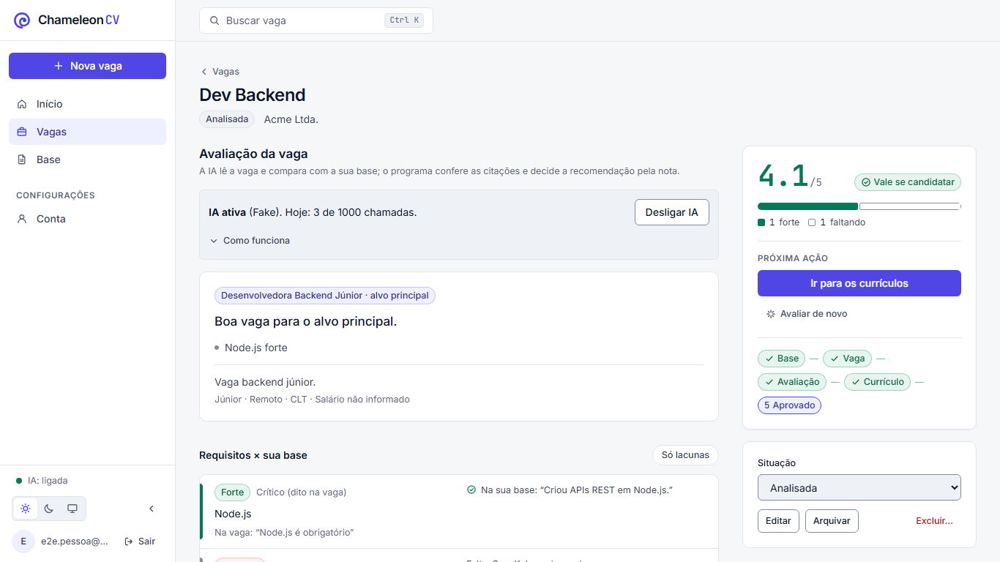
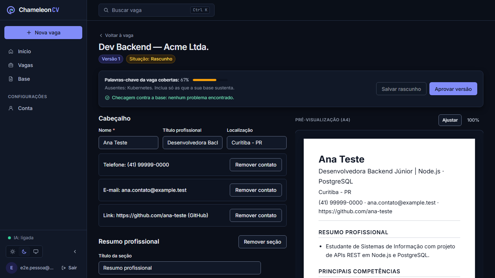
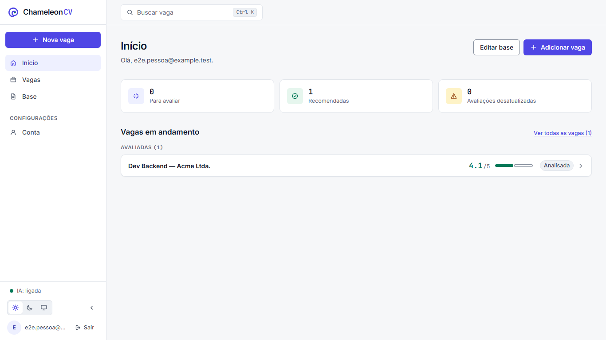
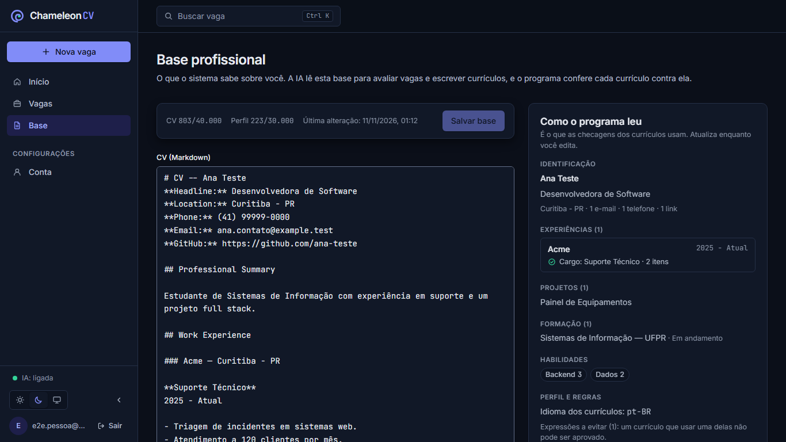

# ChameleonCV

A personal tool that works like [career-ops](https://github.com/santifer/career-ops): **paste a job posting and get an
evaluation of the job and a resume tailored to it**, written by AI from what the system knows about you and checked by
the program against that knowledge.

1. **Professional base** (page "Base"): your CV in Markdown (the only source of facts, like `cv.md`) and your profile
   and rules (targets, dealbreakers, salary ranges, location policy, framing, writing rules — like `modes/_profile.md`).
   Every save is an immutable revision.
2. **Evaluation** (job page): the AI reads the posting alone (requirements, importance, keywords), then judges it against
   your base: type of role, broken rules, match per requirement with evidence quoted from your CV, gaps with mitigation,
   scores, a 1-5 score, a verdict and a suggested salary. The program checks every quote and decides the recommendation
   from the score (4.0+ apply, 3.5-3.9 only with a reason, below: don't).
3. **Tailored resume**: the AI writes the headline, summary, key skills and bullets with the job's keywords; the program
   keeps titles, companies, dates and links from your CV and flags invented numbers, changed titles, seniority claims,
   avoided expressions and terms your base does not support. You edit, approve (immutable) and export DOCX/PDF.

Product definition: [`docs/REDEFINICAO_PRODUTO_PESSOAL.md`](docs/REDEFINICAO_PRODUTO_PESSOAL.md) · architecture:
[`docs/architecture.md`](docs/architecture.md) · decisions:
[`ADR-0015`](docs/decisions/ADR-0015-fluxo-career-ops-base-markdown.md) (flow),
[`ADR-0016`](docs/decisions/ADR-0016-design-system-temas.md) (design system and themes).

## Screenshots

Synthetic data (scripted AI and a sample base). More screens, both themes, and the full report of the redesign
(including what went wrong and what is still missing): [`docs/RELATORIO_IDENTIDADE_VISUAL.md`](docs/RELATORIO_IDENTIDADE_VISUAL.md).

| Job: score, evidence rail, next action, requirement matrix     | Resume editor: form and A4 sheet side by side                       |
| -------------------------------------------------------------- | ------------------------------------------------------------------- |
|  |  |

| Home: work queue                                             | Base: "how the program read it"                          |
| ------------------------------------------------------------ | -------------------------------------------------------- |
|  |  |

## Interface

- **Light, dark and system themes**, applied before the first paint (no flash). Switch in the sidebar, on the login page or
  in Account, or press `Ctrl/Cmd+Shift+L`.
- **Color carries meaning:** indigo is for what you click; green only for what your base proves (good score, "apply",
  strong match, approved); amber asks for attention; red blocks. The A4 preview stays white in both themes because it is
  the exported file.
- **Shortcuts:** `Ctrl/Cmd+K` search jobs · `Ctrl/Cmd+S` save (Base and resume editor) · `Esc` close menus and dialogs.
- Collapsible sidebar (a drawer on phones), skeletons while loading, jobs prefetched on hover, Base and editor loaded on
  demand (initial JS: 165 KB gzip). Reference for new screens: [`docs/design-system.md`](docs/design-system.md).

## Structure

| Path                 | Contents                                                                  |
| -------------------- | ------------------------------------------------------------------------- |
| `apps/api`           | Express 5 API (auth, base, jobs, evaluation, resumes, export)             |
| `apps/web`           | React 19 + Vite + Tailwind 4 SPA                                          |
| `packages/contracts` | Zod contracts shared by API and web                                       |
| `packages/domain`    | Pure rules: CV reader, resume builder, career-ops checks, evaluation gate |
| `packages/ai`        | Multi-provider router (Gemini, Groq, ...) and the career-ops prompts      |
| `packages/db`        | Prisma 7 + PostgreSQL (the only package that imports `@prisma/*`)         |
| `packages/documents` | DOCX/PDF/HTML rendering                                                   |

## Requirements

- Node.js 24, pnpm 12, PostgreSQL 16+ binaries (Docker is **not** required).
- **At least one AI key** in `.env` (the Gemini key is free: https://aistudio.google.com/apikey). Without AI the
  evaluation is unavailable and the resume is your base without tailoring.

## Setup

```bash
pnpm install
cp .env.example .env   # fill in an AI key; .env is never committed
pnpm db:local:init     # once: creates a private cluster in .data/pg (127.0.0.1:54329)
pnpm db:local:start
pnpm db:migrate:deploy
pnpm dev               # API on :3000, web on :5173
```

Create the first account with an invite: `pnpm --filter @chameleon/api admin:invite you@example.com`.

## Commands

| Command                 | What it does                                                                                                                                                                                                       |
| ----------------------- | ------------------------------------------------------------------------------------------------------------------------------------------------------------------------------------------------------------------ |
| `pnpm dev`              | API and web in development mode                                                                                                                                                                                    |
| `pnpm check`            | formatting, lint, types and unit/component tests (no database, no network)                                                                                                                                         |
| `pnpm test:integration` | tests against a real local PostgreSQL                                                                                                                                                                              |
| `pnpm test:e2e`         | Playwright on the real stack with a scripted AI: base → job → evaluation → resume → approve → file; plus every main screen in both themes with axe's real color-contrast check (screenshots in `e2e/.tmp/screens`) |
| `pnpm ai:check`         | validate the configured AI keys and models                                                                                                                                                                         |
| `pnpm build`            | build the API and the web app                                                                                                                                                                                      |

## Rules enforced automatically

- `@prisma/*` only in `packages/db`; `apps/web` only imports `@chameleon/contracts` (ESLint + `tests/architecture`).
- `apps/web` colors only through the design tokens of `apps/web/src/index.css`: a raw Tailwind palette class or a hex
  color in a component fails `tests/architecture/design-tokens.test.ts`.
- Every private table is scoped to its owner (`forOwner`, composite FKs, immutable `ownerId`); the isolation suite in
  `tests/integration/isolation` fails if a new route has no cross-owner test.

## Privacy

Real data never enters the repository: fixtures are synthetic and personal files live in `fixtures-private/` (ignored by
git). Phone and e-mail are removed from every AI prompt. Secrets live only in `.env`.
