# Relatório — identidade visual, UI/UX e tema escuro

**Período:** 10 e 11/11/2026 · **Branch:** `feat/visual-identity` (integrada à `main`) · **Plano:**
[PLANO_IDENTIDADE_VISUAL.md](PLANO_IDENTIDADE_VISUAL.md) · **Referência de uso:** [design-system.md](design-system.md) ·
**Decisão:** [ADR-0016](decisions/ADR-0016-design-system-temas.md)

Este relatório registra o que foi feito, como foi verificado, o que deu errado no caminho e o que ficou de fora. As capturas
usam só dados sintéticos (provedor de IA roteirizado, base de exemplo "Ana Teste", conta `e2e.pessoa@example.test`).

---

## 1. Ponto de partida

| Achado (10/11, `main` em `db3bc4f`) | Dado medido |
|---|---|
| Aparência | Tailwind padrão, quase preto e branco, sem marca, fonte nem favicon |
| Cores nos componentes | 255 classes cruas (`slate-*`, `blue-*`, `red-*`…), nenhum token |
| Tema escuro | inexistente (0 usos de `dark:`) |
| Estados de interação | 16 `hover:`, 1 `active:`, 0 transições, 0 `aria-busy` |
| Fluidez | 0 rotas sob demanda, 0 pré-carregamentos, carregamentos só com texto |
| Significado das cores | azul era ação **e** informação; verde significava "forte", "aprovada" e "salva" |

O pedido: um painel profissional com cores de produto, rápido e fluido, com tema escuro e todos os estados que um frontend
profissional tem.

## 2. Processo

1. **Revisão do plano** (antes de qualquer código): o plano anterior era neutro (grafite + verde) e deixava o tema escuro
   fora do escopo. Foi reescrito com cor de marca índigo, paletas clara e escura com contraste WCAG calculado par a par,
   uma tabela de estados por componente e metas de fluidez. Dois pares falharam no cálculo e foram trocados antes da
   implementação: o verde de "parcial" no claro (`#10b981`, 2,54 → `#0d9467`, 3,85) e o botão destrutivo no escuro
   (`#ef4444` com branco, 3,76 → `#dc2626`, 4,83). Commit `d629517` na `main`.
2. **Implementação por fases** na branch `feat/visual-identity`, cada fase com testes verdes e commit próprio:

| Commit | Fase | O que entrou |
|---|---|---|
| `32b4ecc` | 1–2 Fundamentos e estrutura | Tokens claro/escuro, script de tema sem piscar, fontes, estados nos componentes, `Dialog`, `Toast`, `Skeleton`, `Mark`, `ThemeToggle`, barra lateral, busca `Ctrl+K` |
| `c8ee630`, `043a9ab` | 3 Dados de apoio (API) | Resumo da avaliação em `GET /api/jobs`; `POST /api/profile/reading`; caso de isolamento A × B e testes de API |
| `b770b55` | 4–5 Vagas e Editor | Lista densa, Início como fila de trabalho, Vaga em duas colunas com matriz de requisitos, editor dividido com barra fixa |
| `dd3698c` | 6 Base e demais | Base com painel "Como o programa leu", histórico, login, convite, Conta, 404 |
| `08dce36` | 7 Varredura | Rotas sob demanda, teste de arquitetura contra cores cruas, `design-system.md`, ADR-0016 |
| `1287788` | 8 Portão final | Teste visual nos dois temas com axe real, correções achadas nas capturas |

3. **Verificação visual real**: o jsdom não calcula cores, então foi criado `e2e/visual-themes.spec.ts`, que abre as telas
   principais num Chromium, nos dois temas, roda o axe com a regra de contraste ligada e salva capturas. As capturas foram
   revisadas uma a uma; os problemas encontrados estão na seção 5.

## 3. Resultado

### Telas — tema claro

| Início (fila de trabalho) | Vagas (lista densa) |
|---|---|
| 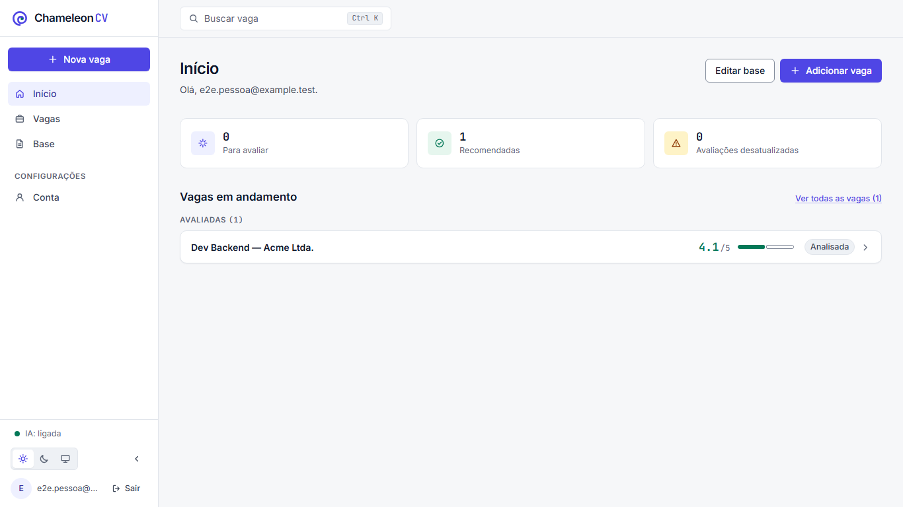 | 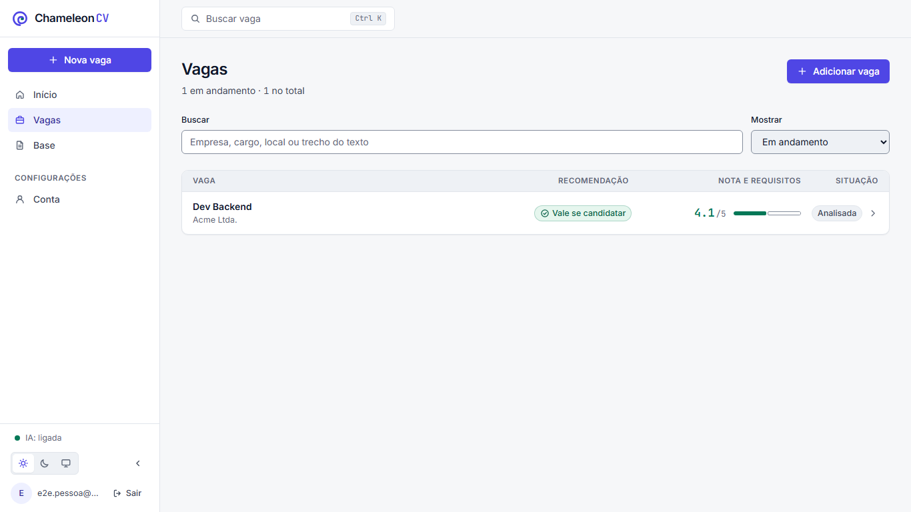 |

| Vaga (nota, trilho e próxima ação) | Editor de currículo (formulário + A4) |
|---|---|
| 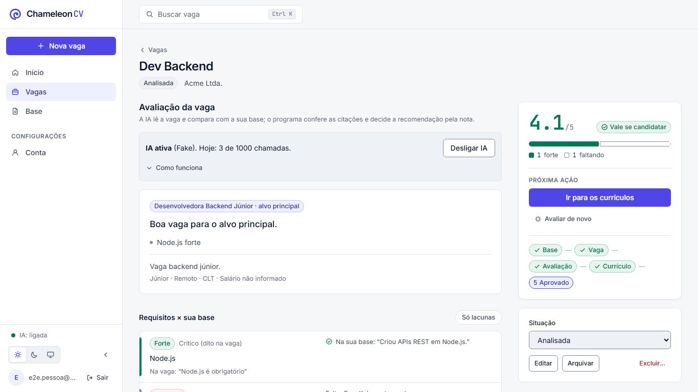 | 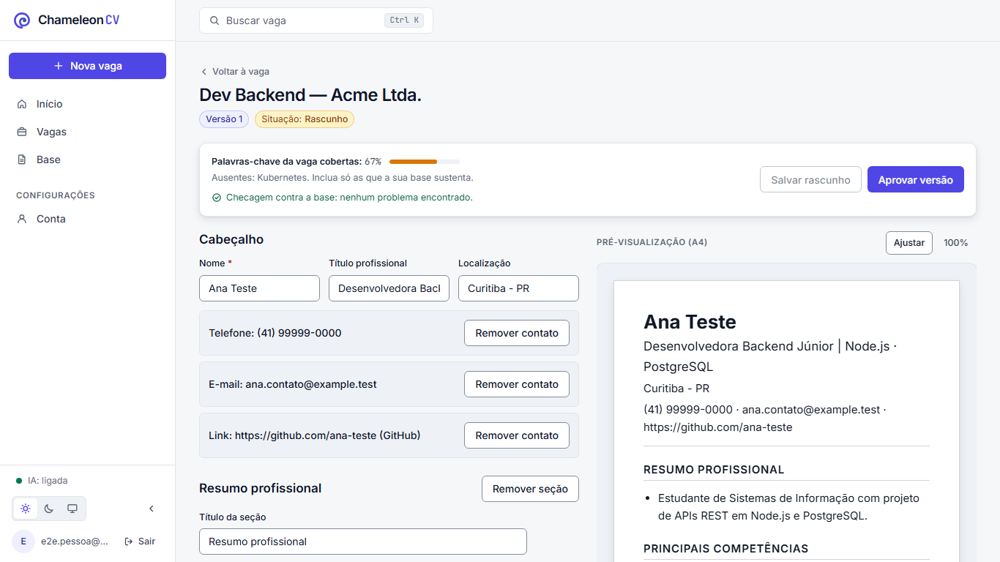 |

| Base ("Como o programa leu") | Conta (tema e sessão) |
|---|---|
| 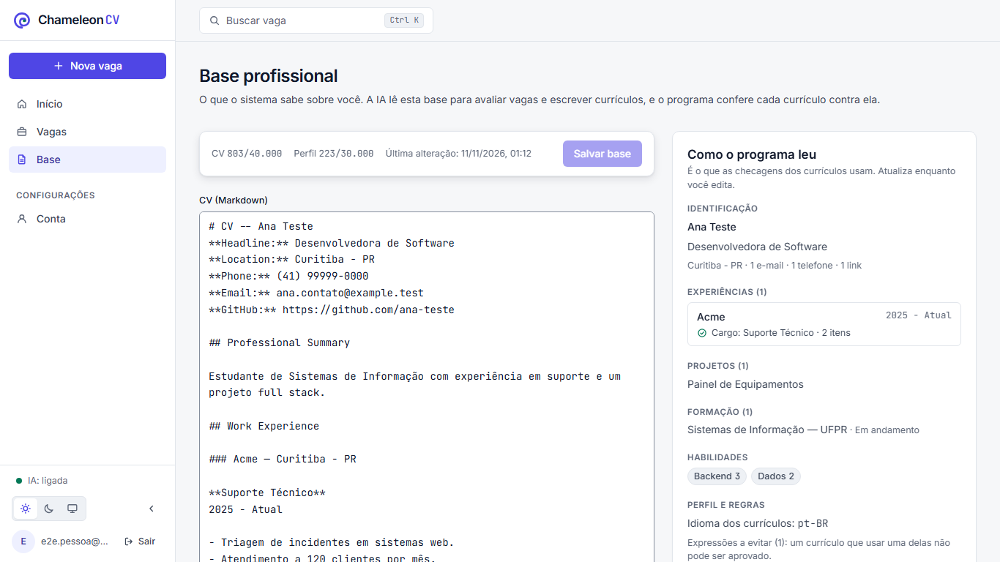 | 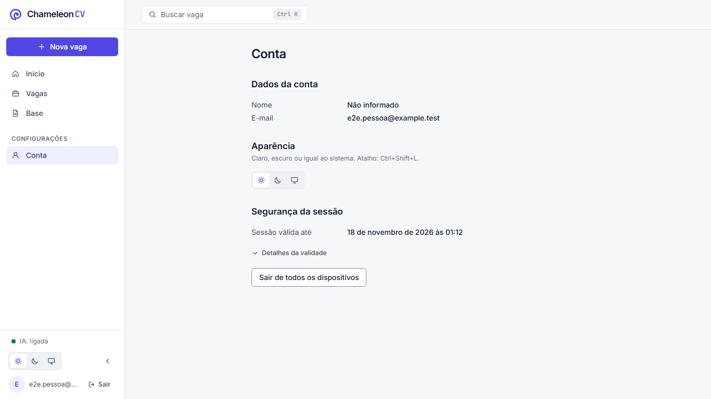 |

### Telas — tema escuro

| Início | Vagas |
|---|---|
| 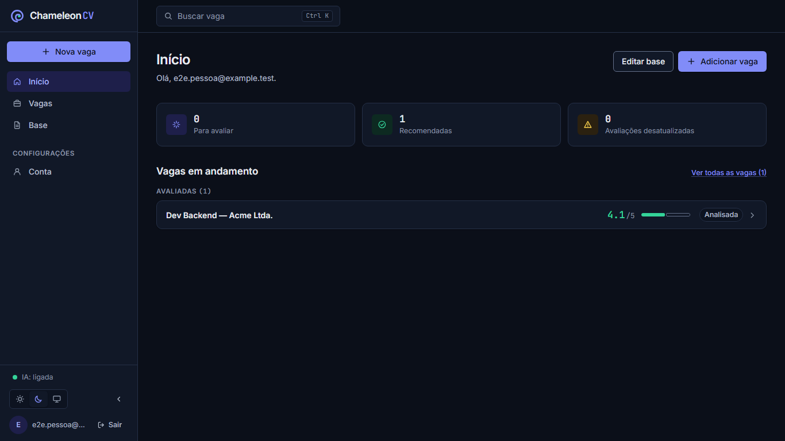 | 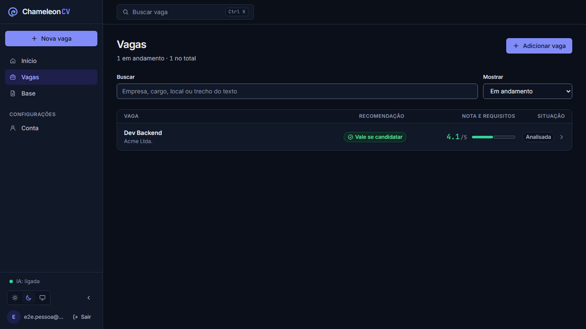 |

| Vaga | Editor (a folha A4 continua branca) |
|---|---|
| 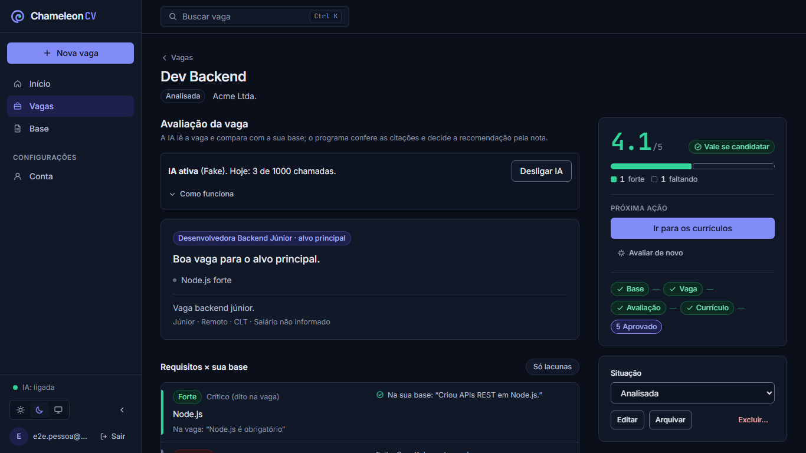 | 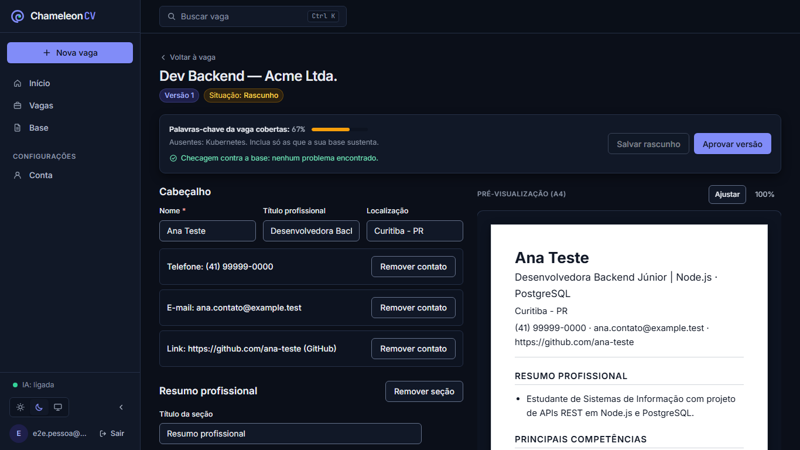 |

| Base | Celular: menu em gaveta |
|---|---|
| 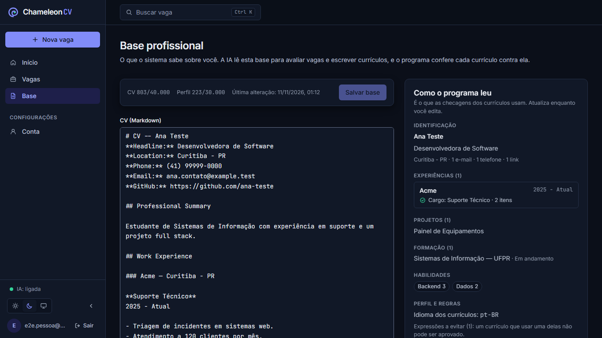 | 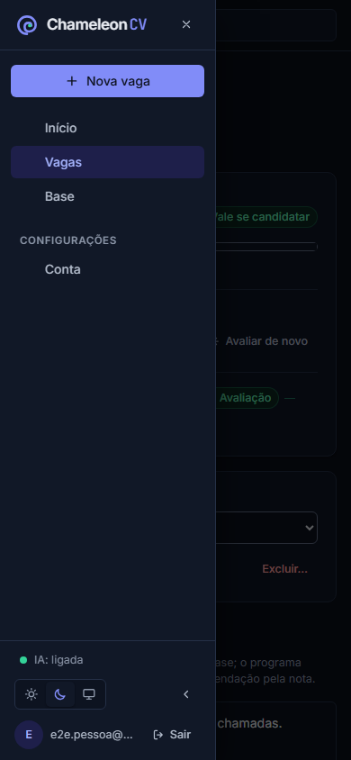 |

Vaga no celular (390 px, página inteira): [light-vaga-mobile.png](images/interface/light-vaga-mobile.png).

### O que mudou para quem usa

- **Cor com significado:** índigo em tudo que se clica; verde só onde a base comprova (nota boa, "Vale se candidatar",
  requisito forte, versão aprovada); âmbar pede atenção; vermelho bloqueia.
- **Tema:** Claro, Escuro e Sistema, sem piscar na carga; seletor na barra lateral, no login e em Conta; `Ctrl+Shift+L`.
- **Estados:** botões, links, campos, menus, linhas e abas com hover, pressionado, foco visível, desabilitado, carregando
  (spinner no próprio botão, `aria-busy`) e selecionado; transições de 150 ms desligadas com movimento reduzido.
- **Navegação:** barra lateral recolhível (gaveta no celular) com Nova vaga, Início, Vagas, Base, Conta, indicador de IA,
  tema e usuário; busca de vagas com `Ctrl/Cmd+K`.
- **Início:** contadores (para avaliar, recomendadas, desatualizadas) e vagas agrupadas pelo que falta fazer; com a base
  vazia, a linha do fluxo e "Preencher a base".
- **Vagas:** cada linha com recomendação, nota e trilho de evidência; esqueletos; a lista anterior fica na tela enquanto o
  filtro carrega; a vaga é pré-carregada ao passar o mouse.
- **Vaga:** painel fixo com nota grande, trilho com legenda, próxima ação (Avaliar / Ir para os currículos), linha do fluxo
  e situação; avaliação como matriz requisito × importância × match × evidência, com filtro "Só lacunas" e "Como a nota foi
  formada" recolhido.
- **Editor:** a partir de 1280 px, formulário e folha A4 lado a lado com zoom; barra fixa com cobertura de palavras-chave,
  checagens, Salvar (`Ctrl+S`) e Aprovar; aviso ao sair com alterações não salvas.
- **Base:** editores em mono com contadores e `Ctrl+S`; painel "Como o programa leu" atualizado enquanto se digita
  (experiências com cargo exato, projetos, formação, habilidades, idioma, expressões a evitar), com alerta quando um cargo
  não é reconhecido.

## 4. Números

| Medida | Antes | Depois |
|---|---|---|
| Cores cruas nos componentes | 255 | **0** (teste `tests/architecture/design-tokens.test.ts` impede voltar) |
| Temas | 1 | **2** + "Sistema" |
| Violações axe (WCAG 2 A/AA, contraste real, 6 telas × 2 temas) | não medido | **0** |
| `hover:` / `active:` / transições (ocorrências diretas) | 16 / 1 / 0 | 39 / 13 / 36, mais as receitas compartilhadas de `styles.ts`, que dão os estados a todo botão, link e campo |
| `focus-visible:` (ocorrências diretas) | 64 | 21 — caiu porque o foco agora vem das receitas centrais, não porque diminuiu a cobertura |
| JS inicial (gzip) | não medido | **165 KB** (meta ≤ 180 KB); Base 4 KB e Editor 6 KB carregam sob demanda |
| Rolagem horizontal a 390 px | não medido | nenhuma (verificado no E2E) |
| Testes | 541 + 389 integração + 1 E2E | **544** (`pnpm check`) + **391** integração + **3** E2E |
| Tamanho da mudança | — | 76 arquivos, +4.167 / −828 linhas |

## 5. Problemas encontrados (e o que foi feito)

| Problema | Como apareceu | Situação |
|---|---|---|
| Dois pares de cor abaixo do contraste mínimo | Cálculo na revisão do plano | Corrigido antes do código |
| Cabeçalho fixo da lista de Vagas cobria a primeira linha | Captura do tema escuro | Corrigido: `overflow-hidden` fazia do contêiner o alvo do `sticky`; trocado por `overflow-clip` |
| Prefixo dos selos ("Situação:") com contraste baixo no claro | axe no Chromium | Corrigido: removida a opacidade reduzida |
| Texto duplicado "Avaliação desatualizada" (selo e alerta) | Teste de componente | Corrigido: o selo do painel diz "Desatualizada" |
| Ordem de títulos pulando nível na lista (h1 → h3) | axe no jsdom | Corrigido: nível do título configurável por linha |
| Duas chamadas ao status da IA ao abrir a vaga | Teste de componente | Corrigido: `staleTime` padrão de 15 s |
| Edições feitas por script de shell quebraram literais de template (três vezes) | Erros de compilação | Corrigido; passei a editar esses trechos com o editor de arquivos |
| Capturas de página inteira mostram a barra lateral vazia | Revisão das capturas | **Artefato da ferramenta**, não do app: capturas do tamanho da janela mostram tudo certo; por isso os prints acima são da janela |
| Teste de login (título da página) falhou uma vez sob carga | Execução completa da suíte | **Não resolvido:** passou em 5 execuções seguintes; causa não identificada |

## 6. Limitações e o que ficou de fora

- **Desvios do plano:**
  - não foram usados subagentes (seção 8 do plano): tudo foi feito numa sessão só;
  - a leitura da base virou `POST /api/profile/reading` em vez de `GET`, para analisar também o texto ainda não salvo;
  - o filtro de Vagas continua um seletor (não um filtro segmentado), e Editar/Arquivar/Excluir ficaram como botões visíveis
    em vez de um menu ⋯;
  - a avaliação com IA mostra o tempo decorrido, não etapas: o servidor faz uma só requisição e não informa a etapa, e
    etapas inventadas seriam falsas;
  - "Tooltip" usa o `title` nativo, não um componente próprio.
- **Não feito:** "Currículos recentes" no Início (exige `GET /api/resumes`); comparar revisões da Base; numeração de linhas
  no editor Markdown; contagem de cliques do fluxo antes/depois (fase 0).
- **Não medido:** LCP e tempo de resposta ao clique (o plano pede < 1,5 s e < 100 ms); só o tamanho do JS foi medido.
- **Fontes:** o build inclui os arquivos de todos os alfabetos (cirílico, grego…); o navegador só baixa o latino pela
  `unicode-range`, mas os arquivos ocupam espaço no build.
- **Formulário do editor:** ganhou tokens e estados, mas não foi redesenhado (botões "Remover contato" repetidos, campo de
  título estreito no layout dividido).
- **Linha do fluxo:** com um rascunho criado, "Aprovado" aparece como etapa atual (com o número 5); pode ser lido como se já
  estivesse aprovado. Vale trocar o texto para "Aprovar".
- **IA real:** todas as telas foram verificadas com o provedor roteirizado. Sem chave de IA configurada, uma avaliação real
  (mais longa) ainda não foi vista na interface.

## 7. Como verificar de novo

```bash
pnpm check              # formato, lint, tipos e testes (inclui o teste de tokens)
pnpm test:integration   # API contra PostgreSQL local
pnpm test:e2e           # fluxo completo + teste visual nos dois temas; capturas em e2e/.tmp/screens
```
